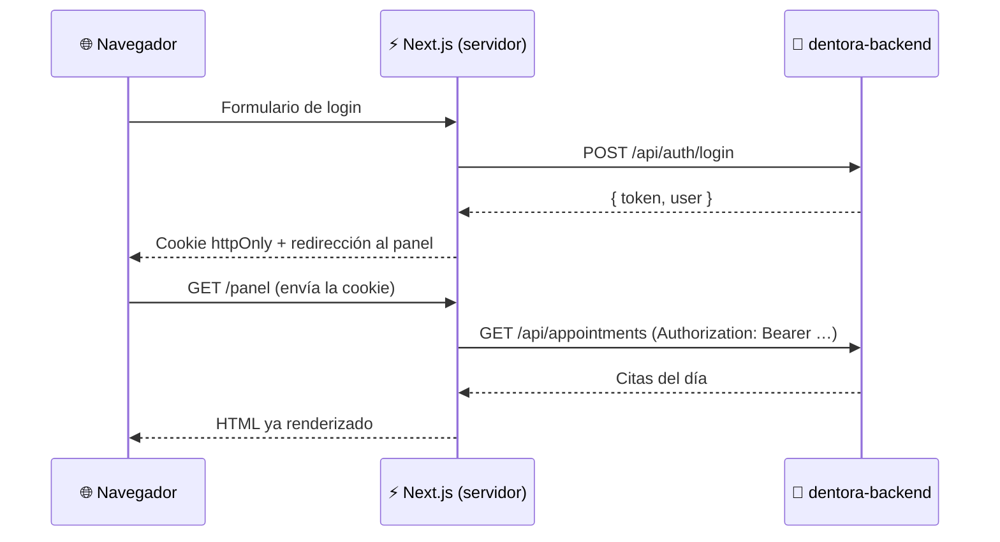

<div align="center">

# 🦷 Dentora Web

**Panel administrativo y web pública de reservas para clínicas dentales.**

Agenda, reservas online, historia clínica, presupuestos, caja y reportes en un solo lugar.


</div>

---

## 📋 Tabla de contenidos

- [Sobre el proyecto](#-sobre-el-proyecto)
- [Funcionalidades](#-funcionalidades)
- [Tecnologías](#️-tecnologías)
- [Arquitectura](#️-arquitectura)
- [Requisitos](#-requisitos)
- [Instalación](#-instalación)
- [Variables de entorno](#-variables-de-entorno)
- [Scripts](#-scripts)
- [Estructura del proyecto](#-estructura-del-proyecto)
- [Rutas](#️-rutas)
- [Sistema de diseño](#-sistema-de-diseño)
- [Convenciones](#-convenciones)
- [Roadmap](#️-roadmap)
- [Proyectos relacionados](#-proyectos-relacionados)

---

## 💡 Sobre el proyecto

**Dentora** es una plataforma SaaS multi-clínica para la gestión de consultorios dentales en Ecuador. Este repositorio contiene todo lo que se ve en el navegador:

| Parte | Para quién | Estado |
|---|---|---|
| **Panel de la clínica** | Dueños, doctores y recepción | ✅ Listo |
| **Web pública de cada clínica** | Pacientes que reservan cita | ✅ Lista |
| **Super-admin** | Equipo de Dentora | ✅ Base lista |
| **Landing de Dentora** | Clínicas que quieren contratar | 📅 Planificado |

Los datos y la lógica de negocio viven en [`dentora-backend`](#-proyectos-relacionados).

---

## ✨ Funcionalidades

**Cuenta y acceso**

- 🔐 **Inicio de sesión seguro**: el token vive en una cookie `httpOnly`, fuera del alcance de JavaScript.
- 🏥 **Registro de clínicas** autoservicio, con 14 días de prueba gratis.
- 👤 **Mi perfil**: cambiar el nombre y la contraseña; al cambiarla se cierran las sesiones en otros dispositivos.
- 👥 **Roles**: dueño, doctor, recepción y asistente, cada uno con su menú y sus permisos.
- 🚫 **Suspensión automática**: si una clínica se suspende, sus sesiones se cierran al instante.

**Agenda y pacientes**

- 📊 **Resumen**: citas del mes, gráfico de 12 semanas, próxima cita y citas de hoy.
- 📅 **Agenda del día**: color por doctor, filtros, agendar, confirmar, reprogramar, cancelar y marcar atendida o no asistió.
- 🔔 **Campana de reservas**: reservas online que esperan confirmación.
- 🔎 **Pacientes**: buscador sin tildes, ficha con historial de citas y consentimiento LOPDP.
- 👩‍⚕️ **Doctores** con editor visual de horario, **tratamientos** con precio, **feriados** y vacaciones.

**Historia clínica** (dueño y doctores)

- 📋 **Antecedentes**: alergias, enfermedades, hábitos y antecedentes dentales.
- 🩺 **Evoluciones** con buscador de diagnósticos **CIE-10**, signos vitales opcionales, candado a las 24 h y aclaraciones.
- 🚨 **Alertas médicas** en rojo en la ficha, la agenda y al agendar, visibles para todo el personal.
- ✅ Al marcar una cita como atendida, se ofrece registrar la evolución.

**Dinero** (dueño, doctores y recepción)

- 🧾 **Presupuestos** con pieza dental, descuentos, aprobación y tratamientos realizados.
- 💵 **Pagos** contra un presupuesto o sueltos, y **recibo** imprimible con número correlativo.
- 🗃️ **Caja** del día, la semana o el mes, por método de pago.
- ⚖️ Etiqueta **«Debe $X»** en la ficha, la agenda y el resumen.
- 🖨️ **Presupuestos y recibos en PDF**: hoja A4 con el logo y el color de la clínica.

**Reportes** (dueño)

- 📈 Ingresos, citas atendidas, pacientes nuevos, inasistencia y cuentas por cobrar, comparados con el período anterior.
- 📊 Ingresos por día, semana o mes; por método de pago; tratamientos más agendados y resultados por doctor.

**Web pública de cada clínica**

- 🌐 **Landing** en `/<slug>`: servicios, equipo y contacto.
- 📆 **Reserva online** en `/<slug>/reservar`: tratamiento, doctor, horario y datos del paciente, con consentimiento LOPDP.

**Experiencia**

- 🌗 **Modo claro, oscuro o del sistema**.
- 🧭 **Menú lateral flotante** que se contrae con <kbd>⌘</kbd> <kbd>B</kbd>.
- 📱 **Responsive**: computador, tablet y celular.
- 🇪🇨 **Pensado para Ecuador**: zona horaria de la clínica, cédula/RUC, dólares y textos en español.

---

## 🛠️ Tecnologías

| Tecnología | Versión | Uso |
|---|---|---|
| [Next.js](https://nextjs.org) | 16 | Framework (App Router, Server Components, Server Actions, Proxy) |
| [React](https://react.dev) | 19 | Interfaz de usuario |
| [TypeScript](https://www.typescriptlang.org) | 5 | Tipado estático |
| [Tailwind CSS](https://tailwindcss.com) | 4 | Estilos y sistema de diseño |
| [jose](https://github.com/panva/jose) | 6 | Lectura de la expiración del JWT |
| [Recharts](https://recharts.org) | 3 | Gráficos del resumen y los reportes (estilo shadcn, en `components/ui/chart.tsx`) |
| [Plus Jakarta Sans](https://fonts.google.com/specimen/Plus+Jakarta+Sans) | — | Tipografía (vía `next/font`) |
| [ESLint](https://eslint.org) | 9 | Calidad de código |

---

## 🏗️ Arquitectura

Dentora Web sigue el patrón **BFF (Backend for Frontend)**: el navegador **nunca** habla directamente con la API.



**¿Por qué así?**

- 🔒 **Más seguro**: un script malicioso no puede robar el token, porque JavaScript no puede leer una cookie `httpOnly`.
- 🌍 **Sin problemas de CORS**: todas las llamadas salen del servidor de Next.
- ⚡ **Más rápido**: las páginas llegan con los datos ya cargados.

**Capas de protección:**

1. **`src/proxy.ts`**: chequeo rápido. Si no hay sesión, redirige al login antes de cargar la página.
2. **`src/lib/dal.ts`**: chequeo real contra el backend en cada página. Valida el rol y cierra la sesión si expiró o si la clínica fue suspendida.
3. **El backend**: valida el token, el rol y la clínica en cada petición. Es la última palabra.

---

## 📦 Requisitos

- [Node.js](https://nodejs.org) **20 o superior**
- [npm](https://www.npmjs.com) 10 o superior
- [`dentora-backend`](#-proyectos-relacionados) corriendo, por defecto en `http://localhost:3000`

---

## 🚀 Instalación

**1. Clona el repositorio**

```bash
git clone https://github.com/TU_USUARIO/dentora-web.git
cd dentora-web
```

**2. Instala las dependencias**

```bash
npm install
```

**3. Configura las variables de entorno**

```bash
cp .env.example .env.local
```

**4. Levanta el backend** (en otra terminal, dentro de `dentora-backend`)

```bash
npm run start:dev
```

**5. Levanta la web**

```bash
npm run dev
```

**6. Abre** 👉 [http://localhost:3001](http://localhost:3001)

> 💡 Para entrar necesitas una cuenta. Créala desde **"Prueba gratis 14 días"** en la pantalla de login.

---

## 🔑 Variables de entorno

| Variable | Descripción | Ejemplo |
|---|---|---|
| `API_URL` | URL del backend. Solo la usa el servidor de Next, nunca el navegador. | `http://localhost:3000/api` |
| `INTERNAL_API_KEY` | Misma clave que en el backend. Permite reenviar la IP real del paciente para el límite de reservas online. | `openssl rand -hex 32` |

> ⚠️ `.env.local` está en `.gitignore`. Nunca subas credenciales al repositorio.

---

## 📜 Scripts

| Comando | Descripción |
|---|---|
| `npm run dev` | Servidor de desarrollo en el puerto **3001** |
| `npm run build` | Build de producción |
| `npm run start` | Sirve el build de producción en el puerto **3001** |
| `npm run lint` | Revisa el código con ESLint |

---

## 📁 Estructura del proyecto

```
src/
├── app/
│   ├── (auth)/              # Login y registro (pantalla dividida)
│   ├── [slug]/              # Web pública de cada clínica y su página de reserva
│   ├── panel/               # Panel de la clínica (requiere sesión)
│   │   ├── layout.tsx       # Menú lateral según el rol + encabezado
│   │   ├── page.tsx         # Resumen
│   │   ├── agenda/          # Agenda del día
│   │   ├── pacientes/       # Listado y ficha (Resumen · Historia clínica · Cuenta)
│   │   ├── caja/            # Pagos del período
│   │   ├── reportes/        # Reportes del dueño
│   │   ├── perfil/          # Mi perfil
│   │   └── …                # Doctores, tratamientos, feriados, ajustes
│   ├── imprimir/            # Presupuesto y recibo listos para imprimir o guardar en PDF
│   ├── admin/               # Super-admin de Dentora
│   ├── actions/             # Server Actions por módulo (citas, pacientes, clínica, cobros…)
│   ├── salir/               # Cierre de sesión forzado (expirada, suspendida o contraseña cambiada)
│   ├── globals.css          # Tokens de diseño y modo oscuro
│   └── layout.tsx           # Layout raíz, tipografía y tema
├── components/
│   ├── ui/                  # Base: Button, Field, Modal, Alert, gráficos…
│   ├── panel/               # Menú lateral, usuario, íconos, gráfico semanal
│   ├── appointments/        # Agendar, reprogramar, acciones de una cita
│   ├── clinical/            # Antecedentes, evoluciones y alertas médicas
│   ├── billing/             # Cuenta del paciente, presupuestos, pagos y saldo
│   ├── reports/             # Indicadores, gráfico de ingresos y rankings
│   ├── print/               # Hoja A4 y cabecera para imprimir
│   ├── public/              # Reserva online de la web pública
│   └── …                    # Doctores, pacientes, ajustes, filtros de listas, tema
├── lib/
│   ├── api.ts               # Cliente HTTP hacia el backend (solo servidor)
│   ├── session.ts           # Manejo de la cookie de sesión
│   ├── dal.ts               # Usuario actual, control de roles y cierre por sesión inválida
│   ├── clinical.ts          # Catálogos: condiciones, alergias, anamnesis y CIE-10
│   ├── billing.ts           # Etiquetas y cálculos de presupuestos y pagos
│   ├── time.ts              # Fechas en la zona horaria de la clínica
│   └── types.ts             # Tipos compartidos con la API
└── proxy.ts                 # Protección de rutas y slugs en minúsculas
```

---

## 🗺️ Rutas

| Ruta | Acceso | Descripción |
|---|---|---|
| `/login` · `/registro` | Público | Inicio de sesión y registro de una clínica |
| `/<slug>` | Público | Web de la clínica: servicios, equipo y contacto |
| `/<slug>/reservar` | Público | Reserva online |
| `/panel` | Personal | Resumen |
| `/panel/agenda` | Personal | Agenda del día (`?fecha=YYYY-MM-DD`) |
| `/panel/pacientes` | Personal | Pacientes con buscador (`?q=`) |
| `/panel/pacientes/:id` | Personal | Ficha; `?tab=historia` (dueño y doctores) y `?tab=cuenta` (sin asistentes) |
| `/panel/doctores` · `/panel/tratamientos` · `/panel/feriados` | Personal | Catálogos y bloqueos de agenda |
| `/panel/caja` | Dueño, doctores y recepción | Pagos por período y método |
| `/panel/reportes` | Dueño | Reportes del negocio |
| `/panel/perfil` | Personal | Mi perfil y contraseña |
| `/panel/ajustes` · `/agenda` · `/personal` | Dueño | Clínica, reglas de la agenda y personal |
| `/imprimir/presupuesto/:id` · `/imprimir/recibo/:id` | Dueño, doctores y recepción | Documentos para imprimir o guardar en PDF |
| `/admin` | Super-admin | Todas las clínicas |

> 🔤 Las direcciones de las clínicas (`slug`) van en la raíz. Las palabras usadas por Dentora (`panel`, `login`, `imprimir`…) están reservadas en el backend.

---|---|---|
| `/login` | Público | Inicio de sesión |
| `/registro` | Público | Registro de una clínica nueva |
| `/panel` | Personal de la clínica | Resumen con indicadores y gráfico semanal |
| `/panel/agenda` | Personal de la clínica | Agenda del día (`?fecha=YYYY-MM-DD`) |
| `/panel/pacientes` | Personal de la clínica | Pacientes con buscador (`?q=`) |
| `/panel/doctores` | Personal de la clínica | Doctores y horarios |
| `/panel/tratamientos` | Personal de la clínica | Catálogo de tratamientos |
| `/panel/reportes` | Personal de la clínica | Reportes |
| `/panel/ajustes` | Personal de la clínica | Configuración de la clínica |
| `/admin` | Super-admin | Todas las clínicas |

---

## 🎨 Sistema de diseño

Estilo **"Clínico moderno"** en formato dashboard: menú lateral oscuro, tarjetas blancas con mucho aire y el turquesa asociado a la salud dental.

| Token | Color | Uso |
|---|---|---|
| `brand-500` |  | Color principal, botones, enlaces |
| `brand-50` |  | Fondos suaves y elemento activo del menú |
| `ink` |  | Texto principal |
| `muted` |  | Texto secundario |
| `line` |  | Bordes |
| `canvas` |  | Fondo de página |
| `night-900` |  | Menú lateral y tarjetas destacadas |
| `night-800` |  | Opción activa del menú |
| `warm-500` |  | Línea de promedio y acentos |

**Tipografía:** [Plus Jakarta Sans](https://fonts.google.com/specimen/Plus+Jakarta+Sans), cargada con `next/font` (sin peticiones a Google en el navegador).

Los tokens están definidos en `src/app/globals.css` y se usan como clases de Tailwind: `bg-brand-500`, `text-muted`, `border-line`, etc.

**Modo oscuro:** los tokens se redefinen con `[data-theme=dark]` (o con la preferencia del sistema), así que los componentes no necesitan clases `dark:`. La elección se guarda en la cookie `dentora_theme`.

**Documentos impresos:** las páginas de `/imprimir` usan colores fijos (grises y el color de la clínica), no los tokens, para que el papel salga igual con cualquier tema.

---

## 📐 Convenciones

- **Llamadas a la API**: siempre con `api()` de `src/lib/api.ts`, desde Server Components o Server Actions. Nunca desde el navegador.
- **Páginas protegidas**: llaman a `requireClinicUser()` o `requireSuperAdmin()` de `src/lib/dal.ts`, y revisan el rol si la sección es restringida.
- **Formularios**: usan `useFormAction` (envío con `onSubmit`) para que React 19 no borre los campos cuando el servidor devuelve un error.
- **Modales**: con `Modal` de `components/ui/modal.tsx`, que bloquea el scroll de la página de atrás.
- **Colores**: usa los tokens (`brand-*`, `ink`, `muted`, `line`, `canvas`), no colores sueltos.
- **Fechas y horas**: con las funciones de `src/lib/time.ts`, siempre en la zona horaria de la clínica.
- **Textos de la interfaz**: en español.
- **Commits**: [Conventional Commits](https://www.conventionalcommits.org) en inglés (`feat:`, `fix:`, `chore:`…).

---

## 🛣️ Roadmap

- [x] Login, registro de clínica y sesión segura
- [x] Resumen, agenda del día y campana de reservas
- [x] Pacientes, doctores, tratamientos, feriados y ajustes
- [x] Agendar, reprogramar y cambiar el estado de las citas
- [x] Web pública de cada clínica con reserva online
- [x] Modo claro y oscuro
- [x] Historia clínica con CIE-10 y alertas médicas
- [x] Presupuestos, pagos, recibos y caja
- [x] Reportes
- [x] Mi perfil
- [x] Super-admin con listado de clínicas
- [ ] Odontograma
- [ ] Recetas e historia clínica en PDF
- [ ] Calendario semanal por doctor
- [ ] Recuperar contraseña y recordatorios por correo
- [ ] Recordatorios por WhatsApp
- [ ] Landing de Dentora con planes y precios

---

## 🔗 Proyectos relacionados

| Repositorio | Descripción |
|---|---|
| **dentora-backend** | API REST multi-clínica: NestJS + PostgreSQL + Prisma |
| **dentora-web** | Este repositorio |
| **dentora-app** | App móvil en Flutter *(próximamente)* |

---

<div align="center">

Hecho con 🦷 en Ecuador

**© 2026 Dentora. Todos los derechos reservados.**

</div>
